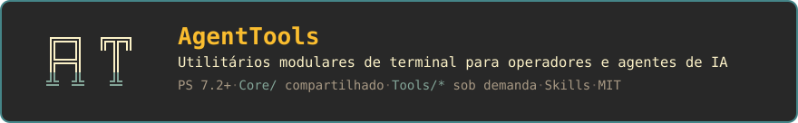

<p align="center">
  
</p>

<p align="center">
  
  
  
  
  <a href="https://github.com/defNickTCys/AgentTools/actions/workflows/ci.yml"></a>
</p>

# AgentTools

AgentTools é um módulo para PowerShell 7.2+ no Windows 11 que reúne utilitários de terminal pensados para operadores e para agentes de IA. Cada ferramenta é isolada e carregada apenas quando é usada. Hoje o módulo exporta o comando `icp`.

## Visão do módulo

O módulo é macro: um núcleo compartilhado e ferramentas independentes.

- **`Core/`** concentra o que todas as ferramentas usam: carregamento, ocultação de segredos, temas, controle do terminal e inspeção de processos.
- **`Tools/<nome>/`** guarda cada ferramenta com manifesto, motor e contrato próprios. O código da ferramenta só entra em memória na primeira chamada que precisa dele.
- **`skills/`** traz *skills* no padrão aberto *Agent Skills*, para que agentes de IA saibam usar as ferramentas.

## Ferramentas

| Ferramenta | Comando | O que faz | Documentação |
|---|---|---|---|
| `icp` | `icp { ... }` | Executa cada comando de um bloco uma vez, em sequência e em escopo isolado, para na primeira falha e gera um relatório estruturado `versao="2"` em XML, JSON ou Markdown. | [Guia do `icp`](Tools/icp/README.md) · [Contrato do relatório](Tools/icp/Contracts/REPORT_CONTRACT.md) · [Skill para agentes](skills/icp/SKILL.md) |

## Requisitos

- Windows 11.
- PowerShell 7.2 ou superior (`pwsh`).
- Git para clonar o repositório e Pester 5 ou superior para rodar os testes.

## Instalação rápida

Clone o repositório em uma pasta chamada `AgentTools` dentro de um diretório listado em `$env:PSModulePath`. Para listar esses diretórios, rode `$env:PSModulePath -split [IO.Path]::PathSeparator`. O exemplo abaixo usa o diretório de módulos do usuário, dentro de `Documents\PowerShell\Modules`.

```powershell
$modulos = Join-Path ([Environment]::GetFolderPath('MyDocuments')) 'PowerShell\Modules'
New-Item -ItemType Directory -Path $modulos -Force | Out-Null
$destino = Join-Path $modulos 'AgentTools'
git clone https://github.com/defNickTCys/AgentTools.git $destino
Import-Module AgentTools
icp -Help
```

Se você já mantém uma cópia do repositório em outro local, abra o PowerShell na raiz dessa cópia e crie uma *junction* NTFS, um vínculo de diretório que faz a cópia aparecer no caminho de módulos. O destino `Documents\PowerShell\Modules\AgentTools` precisa estar livre.

```powershell
$origem = (Get-Location).Path
$modulos = Join-Path ([Environment]::GetFolderPath('MyDocuments')) 'PowerShell\Modules'
New-Item -ItemType Directory -Path $modulos -Force | Out-Null
$destino = Join-Path $modulos 'AgentTools'
New-Item -ItemType Junction -Path $destino -Target $origem | Out-Null
Import-Module AgentTools
```

## Exemplo rápido

```powershell
icp { Get-Location; Get-ChildItem -Name }
icp -Format json -OutFile .\relatorio.json { Get-Location }
icp -Help -Full
```

A referência completa de parâmetros, variáveis de ambiente e exemplos está no [guia do `icp`](Tools/icp/README.md).

## Skills para agentes de IA

O repositório inclui a skill oficial do `icp` no padrão aberto *Agent Skills* em [skills/icp/SKILL.md](skills/icp/SKILL.md), alinhada ao contrato `versao="2"` e aos parâmetros da `1.0.0`.

Ela pode ser instalada com `npx skills add defNickTCys/AgentTools` ou vinculada diretamente a partir do diretório `skills/icp` do seu clone local.

## Arquitetura

- `AgentTools.psd1` declara os metadados do módulo e exporta `icp`. `AgentTools.psm1` carrega o núcleo e o ponto de entrada da ferramenta.
- `Core/` reúne carregamento, ocultação de segredos, temas, controle do terminal e inspeção de processos.
- `Tools/<nome>/` contém as ferramentas isoladas. O motor de `icp` é carregado na primeira chamada que precisa dele.
- `skills/` guarda as *skills* para agentes de IA.
- `Tests/` reúne os testes Pester.

## Verificação

Na raiz do repositório, em um processo limpo iniciado com `pwsh -NoProfile -NoLogo`, execute:

```powershell
Test-ModuleManifest .\AgentTools.psd1
Import-Module Pester -MinimumVersion 5.0
Invoke-Pester -Path .\Tests
```

## Contribuição e autoria

Abra uma branch de tarefa e use o [template de pull request](.github/pull_request_template.md) para registrar escopo e verificações. Escreva mensagens de commit em português no formato `TASK-NNN Un: descrição`.

`Author` e `Committer` identificam a conta do mantenedor, `defNickTCys`, com o e-mail `noreply` do GitHub. Registre a participação de pessoas e agentes nos *Git trailers*, campos no rodapé da mensagem de commit, com `Actor`, `Agent-Role`, `Agent-Model` e `Reviewed-By-Model`. Use os rótulos `actor:*`, `review:*` e `area:*` no PR. [Guia de contribuição](AGENTS.md)

## Licença

O AgentTools é distribuído sob a [licença MIT](LICENSE).
